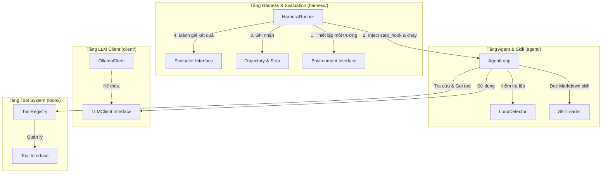

# Sơ Đồ Kiến Trúc & Sơ Đồ Lớp (UML Class Diagram) - Ollama AI Agent

Hệ thống AI Agent tuân thủ nghiêm ngặt mô hình phân tách tầng (**Abstraction Layers**) và áp dụng **4 Design Patterns** cốt lõi:
1. **Strategy Pattern**: Dành cho `Evaluator` (`FunctionalEvaluator`, `KeywordEvaluator`, `VLMEvaluator`).
2. **Template Method Pattern**: Dành cho `AgentLoop` định khung vòng lặp ReAct (`observe` -> `think` -> `act`).
3. **Registry / Factory Pattern**: Dành cho `ToolRegistry` quản lý vòng đời và chính sách truy cập `Tool`.
4. **Observer / Hook Pattern**: Dành cho `HarnessRunner` quan sát và thu thập `Trajectory` từ `AgentLoop`.

---

## 1. Sơ đồ Kiến trúc Tổng quan (Architecture Overview Diagram)

---

## 2. Sơ đồ Lớp Chi tiết (Detailed UML Class Diagram)

```mermaid
classDiagram
    direction TB

    %% ==========================================
    %% 1. CLIENT MODULE (Abstract Interface)
    %% ==========================================
    class LLMConfig {
        +string base_url
        +string model_name
        +double temperature
        +int max_tokens
        +int timeout_seconds
    }

    class Message {
        +string role
        +string content
        +vector~string~ images_base64
    }

    class LLMResponse {
        +string content
        +int prompt_tokens
        +int completion_tokens
        +long latency_ms
    }

    class LLMClient {
        <<abstract>>
        +virtual ~LLMClient() = default
        +chat(messages: vector~Message~) expected~LLMResponse, string~*
        +setConfig(config: LLMConfig) void*
    }

    class OllamaClient {
        -LLMConfig config_
        -performHttpPost(endpoint: string, payload: string) expected~string, string~
        +OllamaClient(config: LLMConfig)
        +chat(messages: vector~Message~) expected~LLMResponse, string~
        +setConfig(config: LLMConfig) void
    }

    LLMClient <|-- OllamaClient : Inheritance
    LLMClient ..> Message : Uses
    LLMClient ..> LLMResponse : Returns
    OllamaClient *-- LLMConfig : Composition

    %% ==========================================
    %% 2. TOOLS MODULE (Registry / Factory Pattern)
    %% ==========================================
    class ToolResult {
        +bool success
        +string output
        +optional~string~ error_message
    }

    class Tool {
        <<abstract>>
        +virtual ~Tool() = default
        +name() string*
        +description() string*
        +execute(args_json: string) optional~ToolResult~*
    }

    class ExecTool {
        +name() string
        +description() string
        +execute(args_json: string) optional~ToolResult~
    }

    class FileTool {
        +name() string
        +description() string
        +execute(args_json: string) optional~ToolResult~
    }

    class WebSearchTool {
        +name() string
        +description() string
        +execute(args_json: string) optional~ToolResult~
    }

    class MemoryTool {
        -string db_path_
        +name() string
        +description() string
        +execute(args_json: string) optional~ToolResult~
    }

    class CalculatorTool {
        +name() string
        +description() string
        +execute(args_json: string) optional~ToolResult~
    }

    class ToolRegistry {
        <<Registry / Factory Pattern>>
        -unordered_map~string, shared_ptr~Tool~~ tools_
        -unordered_map~string, function~unique_ptr~Tool~()~~ factories_
        -unordered_set~string~ allowed_tools_
        -unordered_set~string~ denied_tools_
        +registerTool(tool: shared_ptr~Tool~) void
        +registerFactory(name: string, creator: function~unique_ptr~Tool~()~) void
        +getTool(name: string) shared_ptr~Tool~
        +setPolicy(allow_list: vector~string~, deny_list: vector~string~) void
        +isAllowed(name: string) bool
        +generateToolsPrompt() string
    }

    Tool <|-- ExecTool
    Tool <|-- FileTool
    Tool <|-- WebSearchTool
    Tool <|-- MemoryTool
    Tool <|-- CalculatorTool
    Tool ..> ToolResult : Returns
    ToolRegistry o-- Tool : Aggregation

    %% ==========================================
    %% 3. AGENT MODULE (Template Method Pattern)
    %% ==========================================
    class Skill {
        +string name
        +vector~string~ keywords
        +string markdown_content
    }

    class SkillLoader {
        -filesystem_path skills_dir_
        -vector~Skill~ loaded_skills_
        +loadAllSkills() size_t
        +selectSkillsForTask(task_description: string) vector~Skill~
    }

    class LoopStatus {
        <<enumeration>>
        NONE
        WARNING
        CRITICAL_REPEAT
        CRITICAL_PING_PONG
    }

    class LoopDetector {
        -size_t warning_threshold_
        -size_t critical_threshold_
        -vector~string~ action_history_
        +recordAction(tool_name: string, args: string) LoopStatus
        +reset() void
    }

    class StepEvent {
        +int step_id
        +string thought
        +string tool_name
        +string tool_args
        +string tool_result
        +int tokens_used
        +long latency_ms
    }

    class AgentLoop {
        <<Template Method Pattern>>
        #shared_ptr~LLMClient~ client_
        #shared_ptr~ToolRegistry~ tool_registry_
        #SkillLoader skill_loader_
        #LoopDetector loop_detector_
        #int max_steps_
        #function~void(const StepEvent&)~ step_hook_
        +setStepHook(hook: function~void(const StepEvent&)~) void
        +run(task_instruction: string) string
        #observe(last_result: string) virtual string
        #think(history: vector~Message~) virtual expected~LLMResponse, string~
        #act(tool_name: string, tool_args: string) virtual optional~ToolResult~
    }

    SkillLoader *-- Skill : Composition
    AgentLoop *-- SkillLoader : Composition
    AgentLoop *-- LoopDetector : Composition
    AgentLoop o-- LLMClient : Aggregation
    AgentLoop o-- ToolRegistry : Aggregation
    AgentLoop ..> StepEvent : Emits via Hook

    %% ==========================================
    %% 4. HARNESS & EVALUATOR MODULE (Observer & Strategy)
    %% ==========================================
    class Environment {
        <<abstract>>
        +virtual ~Environment() = default
        +setup() bool*
        +teardown() void*
        +workingDirectory() string*
    }

    class NativeEnvironment {
        -string work_dir_
        +setup() bool
        +teardown() void
        +workingDirectory() string
    }

    class SandboxEnvironment {
        -string sandbox_dir_
        +setup() bool
        +teardown() void
        +workingDirectory() string
    }

    class EvalResult {
        +bool passed
        +optional~double~ score
        +string reason
    }

    class Evaluator {
        <<abstract / Strategy Pattern>>
        +virtual ~Evaluator() = default
        +evaluate(task_id: string, final_answer: string) EvalResult*
    }

    class KeywordEvaluator {
        -vector~string~ expected_keywords_
        +evaluate(task_id: string, final_answer: string) EvalResult
    }

    class FunctionalEvaluator {
        -string eval_script_
        +evaluate(task_id: string, final_answer: string) EvalResult
    }

    class VLMEvaluator {
        -shared_ptr~LLMClient~ vlm_client_
        +evaluate(task_id: string, final_answer: string) EvalResult
    }

    class Trajectory {
        +string task_id
        +string model
        +bool success
        +int total_tokens
        +long total_time_ms
        +vector~StepEvent~ steps
        +toJson() string
        +saveToFile(filepath: string) bool
    }

    class HarnessRunner {
        <<Observer / Hook Host>>
        -shared_ptr~AgentLoop~ agent_
        -unique_ptr~Environment~ env_
        -unordered_map~string, shared_ptr~Evaluator~~ evaluators_
        +registerEvaluator(type: string, eval: shared_ptr~Evaluator~) void
        +runSingleTask(task: TaskConfig) Trajectory
        +runBatchEvaluation(tasks_json_path: string, output_dir: string) double
    }

    Environment <|-- NativeEnvironment
    Environment <|-- SandboxEnvironment
    Evaluator <|-- KeywordEvaluator
    Evaluator <|-- FunctionalEvaluator
    Evaluator <|-- VLMEvaluator
    Evaluator ..> EvalResult : Returns
    Trajectory *-- StepEvent : Composition
    HarnessRunner o-- AgentLoop : Injects Hook
    HarnessRunner *-- Environment : Composition
    HarnessRunner o-- Evaluator : Strategy Selection
    HarnessRunner ..> Trajectory : Generates
```

